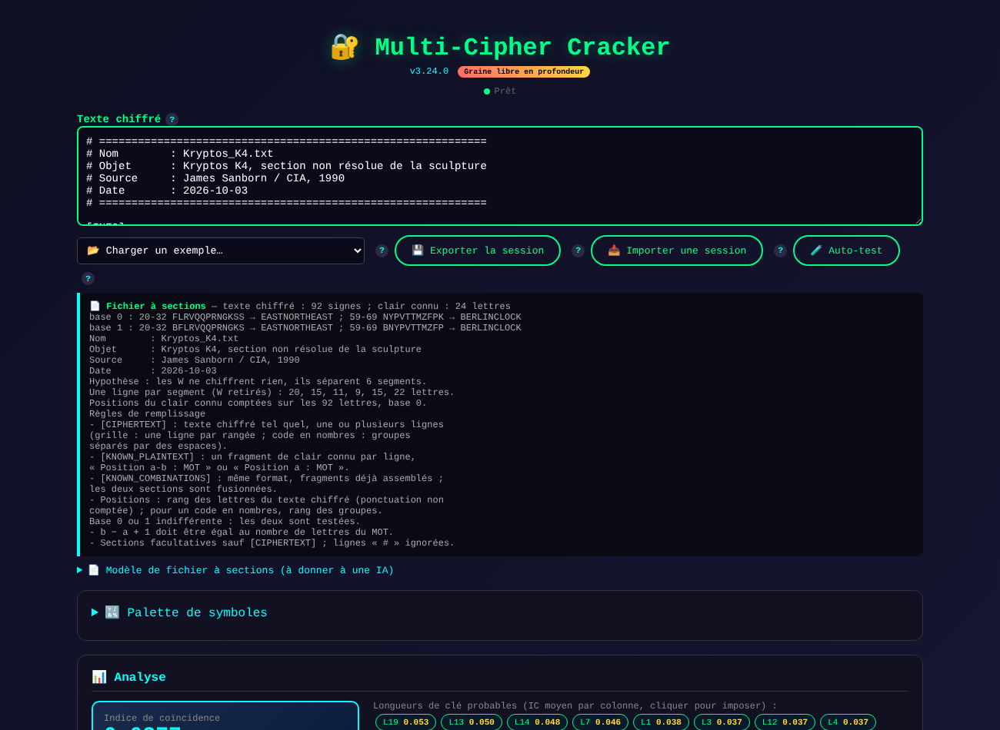
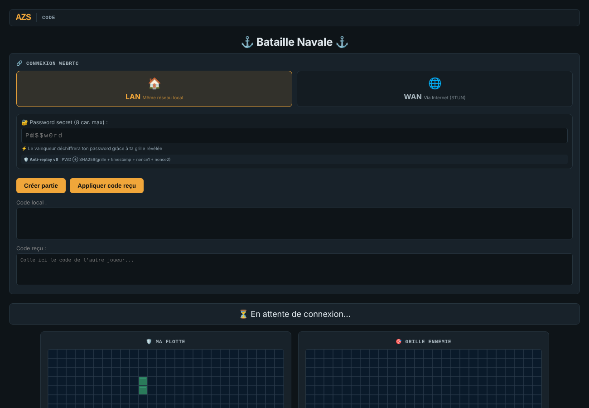

<!--
  Nom      : LISEZMOI.md
  Objet    : Présentation du dépôt code (cryptanalyse et bataille navale cryptographique)
  Auteur   : Eric PERRET
  Date     : 2026-10-17
  Licence  : MIT
-->

# 🔐 Code

🇬🇧 [English version: README.md](README.md)

Deux outils autonomes (un fichier HTML chacun, aucune librairie, aucune installation). Interfaces en français.

| Outil | Lancer |
|---|---|
| Multi-Cipher Cracker v3.24.0 | ▶️ **[multi_cipher_v3_24_0.html](https://ericperret.github.io/code/multi_cipher_v3_24_0.html)** |
| Bataille navale cryptographique v6 | ▶️ **[bataille_navale_v6.html](https://ericperret.github.io/code/bataille_navale_v6.html)** — notice : [BATAILLE NAVALE CRYPTOGRAPHIQUE V6.rtf](<BATAILLE NAVALE CRYPTOGRAPHIQUE V6.rtf>) |

---

## Multi-Cipher Cracker

Cryptanalyse automatique des chiffrements classiques : l'outil analyse le texte chiffré, présélectionne les chiffrements plausibles, lance en parallèle les attaques adaptées et classe les textes clairs obtenus par vraisemblance linguistique (français et anglais). Fonctionne hors ligne, y compris en `file://` : modèles de langue et lexiques sont intégrés au fichier sous forme compressée.

### Utilisation

1. Ouvrir le lien ci-dessus (Chrome / Edge 90+, Firefox 113+, Safari 16.4+) et attendre « Prêt ».
2. Coller le texte chiffré, ou un **fichier à sections** (modèle fourni dans l'outil, ouvert sur Kryptos K4), ou choisir un exemple.
3. **DÉCODE** : encodages simples seuls. **CRACK** : cryptanalyse des chiffrements cochés. **STOP** arrête tout ; les résultats obtenus restent affichés.

### Fonctions

| Fonction | Description |
|---|---|
| Fichier à sections | `[CIPHERTEXT]`, `[KNOWN_PLAINTEXT]` / `[KNOWN_COMBINATIONS]` (« Position a-b : MOT », base 0 et 1 testées), `[INFO]`, lignes `#` ; modèle copiable pour une IA |
| Analyse | Indice de coïncidence, nombre de signes, diagnostic, longueurs de clé probables (clic = imposer) |
| Présélection | Chiffrements cochés automatiquement selon le texte : encodage, groupes de nombres, ADFGVX, symboles, longueur, IC, χ², digrammes, clair connu |
| Décodeurs directs | Base64, Base32, hexa, binaire, ASCII décimal / octal, ROT13, ROT47, Atbash, inversé, Brainfuck exécuté ; chaînés jusqu'à 3 couches ; flag `FLAG{…}` remonté en tête 🚩 |
| Mono-alphabétiques | César, Bi-ROT, Atbash, Affine, Reverse, Substitution (lettres ou symboles) |
| Homophoniques | Homophonique (Zodiac Z408 résolu), mots-symboles (nomenclateur), symboles nuls, codes en groupes de nombres |
| Polyalphabétiques | Vigenère, Beaufort, Beaufort variante, Porta, Gronsfeld, Autokey, Quagmire I à IV ; clé connue, indices, liste CTF, lexique, force brute 1 à 7 lettres ; clair connu imposé par colonne |
| Digrammes et fractionnement | Playfair, Two-Square, Four-Square, Bifid, Hill 2×2, ADFGX / ADFGVX, Nihilist, Deux tables 5×5 + graine (mot-clé ou libre) |
| Transpositions | Rail Fence, Colonnes simples, inverses, doubles ; transposition par grille (rotations, serpentins, diagonales, spirale, période, diagonale torique) ; transposition 3D en pavé |
| Segments W | Option « W = séparateurs » (W et retours à la ligne), vue par segment avec clair connu par colonne |
| Vues | Grille (export PNG), pavé 3D isométrique en SVG (survol, parcours, export PNG), graphique des périodes, palette de symboles |
| Résultats | Au fil de l'eau, meilleur en tête, dépliables ; ligne continue + ligne découpée en mots ; score minimal 15 % |
| Session | Export / import, exemples intégrés (dont Z408 et Z340), aide « ? » sur chaque contrôle |
| Auto-test | Lancé aussi par `?selftest` dans l'URL |

### Méthode

- **Score unique** : log-vraisemblance moyenne des quadrigrammes, calibrée par langue (0 % = aléatoire, 100 % = texte réel) ; pentagrammes et entropie du clair pour l'homophonique ; lexique pour l'affinage et le découpage en mots.
- **Polyalphabétiques** : χ² par colonne puis optimisation de chaque lettre de clé, plus clés entières testées ; une clé n'est retenue que si le clair contient de vrais mots.
- **Recuit simulé** (substitution, homophonique, Playfair, Bifid, carrés, colonnes doubles, deux tables) réparti sur un pool de Web Workers (threads logiques − 1) ; charge découpée en blocs (force brute, dictionnaire, largeurs, graines) ; durée « ∞ » jusqu'à STOP.
- **Preuve de lecture et arrêt** : modèle nul (texte aléatoire aux fréquences de la langue) ; un clair est prouvé si la probabilité de hasard de ses mots × clés testées < 10⁻⁸ ; énumération arrêtée au premier clair prouvé, recuit confirmé par deux graines concordantes.
- **Données** : quadrigrammes FR/EN complets, pentagrammes FR/EN (11,9 M entrées) décompressés à la demande ; corpus Gutenberg (20 ouvrages FR, 27 EN) ; lexiques FrequencyWords 30 000 mots (H. Dave, CC BY-SA 4.0) ; Z408 / Z340 (zodiackillerciphers.com, K. Gorman).

Jeu d'essai : [`jeu de test.txt`](<jeu de test.txt>) (un texte chiffré par méthode, avec sa clé). L'historique détaillé des versions (2.7 → 3.24.0) figure dans le cartouche de `multi_cipher_v3_24_0.html`.

---

## Bataille navale cryptographique

Bataille navale 26 × 26 à deux joueurs, en pair à pair dans le navigateur.

| Fonction | Description |
|---|---|
| Connexion | WebRTC en LAN, ou en WAN via des serveurs STUN publics ; codes de connexion échangés par copier-coller (SMS, mail…) |
| Défi | Le mot de passe de chaque joueur est chiffré par la position de sa flotte : SHA-256(grille + horodatage + nonce1 + nonce2) ; il ne se révèle qu'en coulant toute la flotte |
| Anti-rejeu | Horodatage et nonces propres à chaque partie |
| Flotte | 5 navires, 17 cases, placement automatique au hasard |
| Armes spéciales | Bombe (porte-avions, croix de 5 cases), torpille (sous-marin, ligne entière), radar (destroyer, distance) |

Seul accès réseau : les serveurs STUN, en mode WAN.

---

## Licence

MIT

## Auteur

**Eric PERRET** — [GitHub](https://github.com/ericperret)
